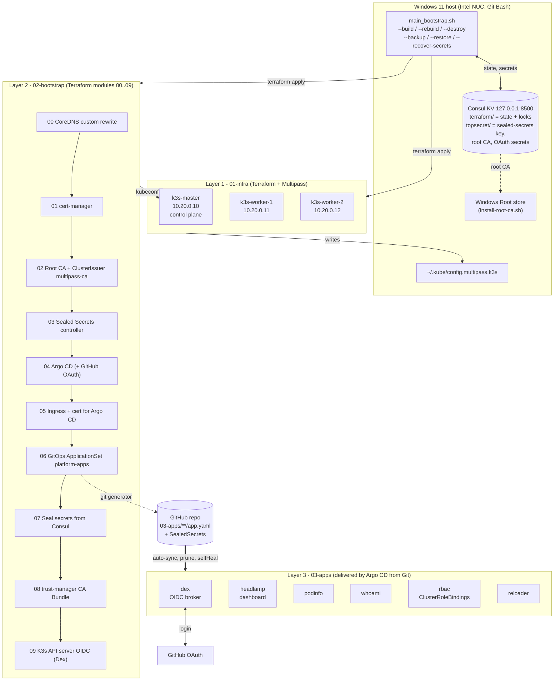
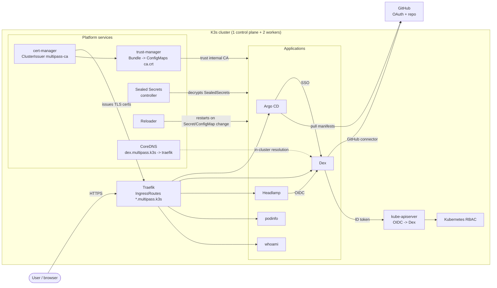
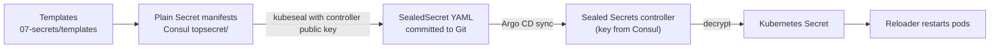

# Architecture

Overview of the Multipass + Terraform + K3s lab (`multipass/k3s`). The Vagrant variants are independent and not shown.

## 1. Layers and deployment flow

## 2. Runtime view (inside the cluster)

## 3. Secrets flow

