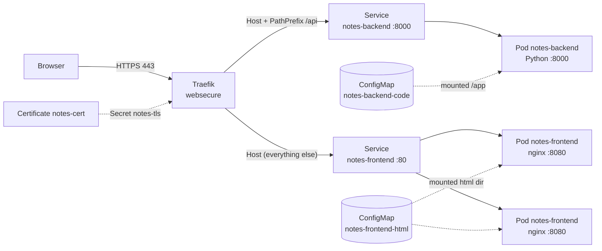
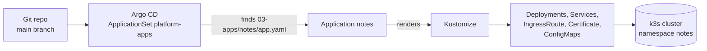

# Notes: Application Architecture

A small two-tier sample application (static frontend + REST backend) deployed to
a k3s cluster by Argo CD. Source: `multipass/k3s/03-apps/notes/` in the
`kubernetes-mate-lab` repository.

## 1. Overview

| Layer | Technology | Replicas | State |
|-------|------------|----------|-------|
| Frontend | `nginxinc/nginx-unprivileged:1.27-alpine` serving a static page | 2 | stateless |
| Backend | `python:3.12-alpine` running a stdlib HTTP server | 1 | notes in memory |
| Ingress | Traefik `IngressRoute` | n/a | n/a |
| TLS | cert-manager `Certificate` issued by `multipass-ca` | n/a | n/a |
| Delivery | Argo CD ApplicationSet + Kustomize | n/a | n/a |

Public URL: `https://notes.multipass.k3s`

Neither tier is built into a custom image. The application code lives in
ConfigMaps generated from `src/` and is mounted into stock images.

## 2. Runtime architecture



ASCII equivalent (for viewers without Mermaid support):

```text
Browser
   | HTTPS
   v
Traefik (entrypoint websecure, TLS from Secret notes-tls)
   |
   |-- Host(notes.multipass.k3s) && PathPrefix(/api) --> Service notes-backend :8000
   |                                                        `--> Pod notes-backend (1)
   |
   `-- Host(notes.multipass.k3s)                     --> Service notes-frontend :80
                                                            |--> Pod notes-frontend (nginx :8080)
                                                            `--> Pod notes-frontend (nginx :8080)
```

## 3. Request flow

1. The browser loads `https://notes.multipass.k3s/`. Traefik terminates TLS
   with the certificate from the `notes-tls` Secret.
2. The route without a path prefix sends the request to the `notes-frontend`
   Service, which load-balances across the two nginx pods. nginx returns
   `index.html`.
3. The page's JavaScript calls relative URLs under `/api` (same origin, so no
   CORS configuration is needed).
4. Traefik matches `PathPrefix(/api)` first and forwards these calls to the
   `notes-backend` Service, which reaches the single Python pod.
5. The backend reads or modifies its in-memory list and responds with JSON.

Traefik gives the `/api` rule priority because it is the longer, more specific
match.

## 4. Components

### 4.1 Frontend

| Item | Value |
|------|-------|
| Image | `nginxinc/nginx-unprivileged:1.27-alpine` (non-root, port 8080) |
| Content | `index.html` mounted read-only over the nginx html directory |
| Replicas | 2 |
| Service | `notes-frontend`, port 80 to container port 8080 |
| Resources | request 10m CPU / 16Mi, limit 50m CPU / 32Mi |
| Probe | `readinessProbe` on `/` |
| Extra volume | `emptyDir` on `/tmp` (nginx needs a writable temp dir) |

The page is plain HTML, CSS and JavaScript with no build step. It uses
`fetch()` to call the API and renders notes with `textContent` (no HTML
injection).

### 4.2 Backend

| Item | Value |
|------|-------|
| Image | `python:3.12-alpine` |
| Command | `python -u /app/server.py` |
| Server | `ThreadingHTTPServer` from the standard library, port 8000 |
| Replicas | 1 (see limitations) |
| Service | `notes-backend`, port 8000 |
| Resources | request 10m CPU / 32Mi, limit 100m CPU / 64Mi |
| Probes | readiness and liveness on `/api/health` |

API:

| Method | Path | Description |
|--------|------|-------------|
| `GET` | `/api/health` | Returns `{"status": "ok"}` |
| `GET` | `/api/notes` | Returns `{"pod": <hostname>, "notes": [...]}`, newest first |
| `POST` | `/api/notes` | Body `{"text": "..."}`, 1 to 280 characters; returns `201` |
| `DELETE` | `/api/notes` | Clears all notes |

Limits: at most 100 notes are kept and request bodies are read up to 4 KiB.
Access to the list is guarded by a lock because the server is multi-threaded.

### 4.3 Networking and TLS

| Resource | Purpose |
|----------|---------|
| `IngressRoute notes` | Two routes on `websecure`: `/api` to the backend, everything else to the frontend |
| `Certificate notes-cert` | Requests a certificate for `notes.multipass.k3s` from ClusterIssuer `multipass-ca` |
| `Secret notes-tls` | Created by cert-manager, referenced by the IngressRoute |

The hostname is resolved by the local DNS server (Technitium) to the cluster.

## 5. Delivery (GitOps)



1. The ApplicationSet scans `multipass/k3s/03-apps/**/app.yaml` on `main`.
2. `app.yaml` provides `name`, `namespace`, `repoURL`, `targetRevision` and
   `kustomizePath`. It carries no Kubernetes resources itself.
3. The generated Application renders the Kustomize path and syncs it with
   `prune` and `selfHeal` enabled; the namespace is created automatically.
4. `kustomization.yaml` builds two ConfigMaps from `src/` with
   `configMapGenerator`. Their names carry a content hash, so editing a source
   file changes the name and automatically rolls the Deployment that mounts it.

## 6. Repository layout

| File | Role |
|------|------|
| `app.yaml` | Discovery file read by the ApplicationSet |
| `kustomization.yaml` | Resource list and ConfigMap generators |
| `backend.yaml` | Backend Deployment and Service |
| `frontend.yaml` | Frontend Deployment and Service |
| `ingressroute.yaml` | Traefik routing |
| `certificate.yaml` | TLS certificate request |
| `src/server.py` | Backend source code |
| `src/index.html` | Frontend source code |
| `README.md` | Short overview |
| `FAILURE-TESTS.md` | Failure simulation exercises |

## 7. Security posture

- Both containers run as non-root with `allowPrivilegeEscalation: false`, all
  capabilities dropped, a read-only root filesystem and the `RuntimeDefault`
  seccomp profile.
- Code is mounted read-only.
- Traffic from the browser is HTTPS only (`websecure` entrypoint).
- Requests are validated (JSON shape, text length, body size).
- Known scanner finding: Trivy KSV-0125 flags images from Docker Hub as
  untrusted registries (informational for this lab).

## 8. Design decisions and limitations

| Decision | Reason | Consequence |
|----------|--------|-------------|
| Code in ConfigMaps | No registry or CI needed; full GitOps from a single push | ConfigMap size limit of 1 MiB; not how production images are shipped |
| Separate Deployments per tier | Independent scaling, rollout and failure | Two Services and two routes |
| Backend runs one replica | State is in process memory | Downtime on restart and data loss; cannot scale out |
| Same-origin `/api` path routing | No CORS and one hostname and certificate | Routing depends on Traefik rule priority |
| Stock public images | Simplicity | Subject to Docker Hub limits and the KSV-0125 finding |

## 9. Evolution path

1. **Persistence:** move notes to PostgreSQL (or Redis). The backend becomes
   stateless and can scale beyond one replica.
2. **Container images:** build with GitHub Actions, push to `ghcr.io` and
   reference versioned tags; split code into its own repository.
3. **Helm chart:** package the manifests with `values.yaml` for several
   environments.
4. **Observability:** expose `/metrics` and add a ServiceMonitor.
5. **Availability:** add `podAntiAffinity` and a PodDisruptionBudget for the
   frontend.
